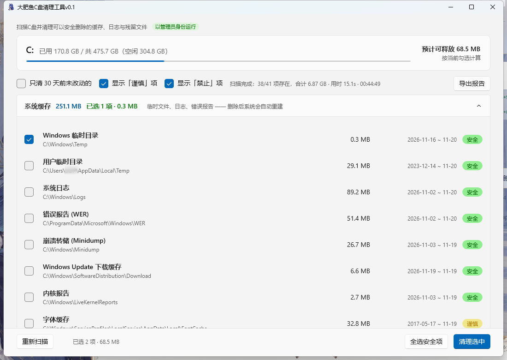

# 清C盘 · C 盘清理工具（Windows）

> 一个 WinUI 3 写的 C 盘清理小工具：**按规则扫描 → 勾选 → 清理 → 记账**。
> 只清缓存/日志/残留，**系统组件和你的数据只显示、不可删**。



---

## 特性

- **规则驱动**：所有清理项写在 `rules.json` 里，可自由增删改，不用改代码
- **三档风险**
  - 🟢 安全：缓存/日志，删了会自动重建（默认勾选）
  - 🟡 谨慎：可能影响体验（字体缓存、缩略图、聊天附件等，默认不勾）
  - 🔴 禁止：系统组件与个人数据（`WinSxS`、`Windows\Installer`、驱动仓库、浏览器 IndexedDB、聊天数据库），**只显示，勾不了也删不了**
- **按时间过滤**：`olderThanDays` 只处理 N 天前的文件；`useAccessTime` 支持按"最后访问时间"判断（适合着色器缓存）
- **通配符路径**：`...\xwechat_files\*\msg\attach` 可匹配任意账号目录
- **整行可点**：点行内任意位置都能切换勾选，鼠标悬停有高亮
- **右键菜单**：`在文件资源管理器中打开` / `删除`（单项删除，同样要确认）
- **清理前二次确认**：按分组列出"将清理 N 项 · X GB"，默认按钮是「取消」
- **清理后记账**：弹窗显示释放量/删除数/被跳过的文件，并写日志
- **记住上次勾选**：关窗口时保存，下次启动自动恢复
- **导出报告**：当前扫描结果一键导成 CSV
- **管理员运行**：启动时提权（部分系统目录需要），标题栏有权限徽章

---

## 运行

从 [Releases](../../releases) 下载：

| 形态 | 说明 |
|---|---|
| `大肥鱼C盘清理工具.exe` | **单文件版**：首次运行解压到 `%LOCALAPPDATA%\BigFishCleaner\`，随后启动 |
| `大肥鱼C盘清理工具-vX.Y.zip` | **文件夹版**：解压后双击 exe，数据就在同一目录 |

系统要求：**Windows 10 1809+ / Windows 11**，需要 **.NET 8 桌面运行时**和 **Windows App Runtime 1.7+**
（大多数装了新版本 Windows 的机器已有后者；没有的话从微软官网装）。

---

## 使用

1. 双击运行，等扫描完成（约 10 秒，取决于规则数量）
2. 勾选要清理的项目（整行都能点）
3. 点「清理选中」→ 确认 → 看结果

**过滤条说明**

| 开关 | 作用 |
|---|---|
| 只清 30 天前未改动的 | 只决定"默认勾选"，**不会禁用**；近 30 天动过的仍可手动勾选 |
| 显示「谨慎」项 | 关掉即隐藏；**隐藏的项会被强制取消勾选且不计入统计**（防误删） |
| 显示「禁止」项 | 同上 |

---

## 规则文件 `rules.json`

首次启动自动生成在程序目录。字段说明：

```jsonc
{
  "version": 1,
  "groups": [
    { "title": "系统缓存", "summary": "临时文件、日志、错误报告 —— 删除后系统会自动重建" }
  ],
  "items": [
    {
      "group": "系统缓存",                    // 所属分组（对应 groups.title）
      "name": "Windows 临时目录",             // 显示名
      "path": "C:\\Windows\\Temp",            // 路径，支持环境变量 / ~ / 通配符 *
      "risk": "safe",                        // safe | careful | forbidden
      "defaultChecked": true,
      "olderThanDays": 0,                    // >0：只统计并清理这么多天前的文件
      "useAccessTime": false,                // true：按最后访问时间判断
      "note": "可选说明"
    }
  ]
}
```

**路径写法**

| 写法 | 含义 |
|---|---|
| `%LOCALAPPDATA%`、`%TEMP%` | 环境变量自动展开 |
| `~\Documents\...` | `~` = 当前用户目录 |
| `...\xwechat_files\*\msg\attach` | `*` 匹配一层目录（适配聊天软件账号目录） |

---

## 安全设计

这程序**真的会删文件**，所以：

1. **禁止项三重锁**：复选框禁用 + 不计入统计 + 右键删除置灰
2. **隐藏即取消**：被过滤掉不显示的项自动取消勾选——**看不见的永远不会被删**
3. **二次确认**：默认按钮是「取消」，回车不会误删
4. **内置规则不碰这些**（见 `rules.json`）：
   - `C:\Windows\WinSxS`（组件仓库，只能用 `DISM /StartComponentCleanup`）
   - `C:\Windows\Installer`（MSI 缓存，删了卸载/修复会坏）
   - `C:\Windows\System32\DriverStore\FileRepository`（驱动仓库，旧驱动要用 `pnputil` 删）
   - 浏览器 `IndexedDB` / `Local Storage` / `Extensions`（登录态与设置）
   - 微信 `db_storage`（聊天数据库）

> ⚠️ **聊天附件特别注意**：微信服务器只保留附件约 **7 天**，之后只剩本地这份。
> 删掉本地附件 = 聊天记录里**永久打不开**。所以这类规则设为「谨慎 + 默认不勾」，且只处理 N 天前的文件。

---

## 生成的文件

| 文件 | 内容 |
|---|---|
| `rules.json` | 清理规则（可编辑） |
| `selection.json` | 上次勾选（自动保存/恢复） |
| `clean-log-*.txt` | 每次清理的明细日志 |
| `scan-report-*.csv` | 「导出报告」生成 |

---

## 自己编译

需要 **.NET 8 SDK**（不需要 Visual Studio）：

```powershell
dotnet build CleanC.csproj -c Release -r win-x64
# 产物：bin\Release\net8.0-windows10.0.19041.0\win-x64\大肥鱼C盘清理工具.exe
```

> **打包时注意**：因为关闭了 PRI 生成（见下），`dotnet publish` **不会带 `App.xbf` / `MainWindow.xbf`**，
> 直接拷 publish 目录会启动崩溃（`0xc000027b`）。用仓库里的 `打包.ps1` 会自动补齐。

`CleanC.csproj` 里这几个属性别删：

```xml
<UseWinUI>true</UseWinUI>
<WindowsPackageType>None</WindowsPackageType>
<EnableCoreMrtTooling>false</EnableCoreMrtTooling>
<EnableDefaultPriItems>false</EnableDefaultPriItems>
<GeneratePriFile>false</GeneratePriFile>
<AppxPackage>false</AppxPackage>
```

后四个用于绕开对 Visual Studio 的依赖：WinUI 3 默认要生成 PRI 资源，而对应的 MSBuild 任务 DLL 只随 VS 分发；非打包应用不需要 PRI。

**打包单文件**：`打包单文件.ps1`（把发布目录压成 zip 嵌进启动器，产物约 10 MB）。

---

## 已知限制

- **微信 `msg\attach` 文件极多**（8 万+），会把总扫描时间拉到 10 秒以上
- **禁止项不做递归统计**（避免 `WinSxS` 十几万文件拖垮扫描），大小显示"未统计"
- **组件清理 / 旧驱动清理** 没做（分别需要 `DISM` 和 `pnputil`），属于系统维护范畴
- **被占用的文件会跳过**，日志里会记录

---

## 目录结构

```
├── CleanC.csproj           项目文件
├── app.manifest            管理员权限 + DPI 感知
├── App.xaml(.cs)           应用入口
├── MainWindow.xaml(.cs)    界面与交互
├── Rules.cs                rules.json 模型 / 加载 / 内置规则
├── Engine.cs               扫描 / 清理 / 日志
├── Model.cs                界面数据模型
├── 启动器\                  单文件版的自解压启动器
├── 打包.ps1 / 打包单文件.ps1
└── docs\screenshot.png
```

---

## License

[MIT](LICENSE)
